# Security and Vulnerability Remediation Scaffolding

Reusable automation for reviewing GitHub security findings and planning dependency upgrades across repositories.

The Python workflow traces vulnerable dependencies and their parent packages, uses npm, Python, and .NET reviewers to recommend compatible upgrades, and exports a remediation plan with Renovate rules for upgrades verified through dependency resolution. Dependabot findings drive package remediation; selected code-scanning findings contribute to the summary.

The pipeline is deterministic and does not require an LLM. Resolution verification checks dependency compatibility on the runner; application builds, tests, and security review remain part of the target project's release process.

## Overall flow

```mermaid
%%{init: {"themeVariables": {"fontSize": "20px"}, "flowchart": {"curve": "linear", "nodeSpacing": 16, "rankSpacing": 24}}}%%
flowchart LR
    subgraph ORCH["SecurityOrchestrator: collect → triage → review → plan → verify → export"]
        direction LR
        subgraph S1[" "]
            direction TB
            A["1. VulnerabilityCollectorAgent<br/>Collect findings"]
            A -.- AD["Collect Dependabot and<br/>selected code-scanning findings"]
        end
        subgraph S2[" "]
            direction TB
            B["2. ArtifactCollectorAgent<br/>Gather repository evidence"]
            B -.- BD["Capture repository reference<br/>Cache manifests, lockfiles, bot PRs"]
        end
        subgraph S3[" "]
            direction TB
            C["3. VulnerabilityTriageAgent<br/>Trace and triage"]
            C -.- CD["Trace dependencies and parent paths<br/>Find fix targets and match bot PRs"]
        end
        subgraph S4[" "]
            direction TB
            D["4. VulnerabilityReviewerAgent<br/>Review candidates"]
            D -.- DD["npm, Python, .NET reviewers<br/>Collect compatible upgrade candidates"]
        end
        subgraph S5[" "]
            direction TB
            E["5. RemediationPlannerAgent<br/>Build remediation groups"]
            E -.- ED["Apply Renovate or fallback groups<br/>Consolidate upgrade targets"]
        end
        subgraph S6[" "]
            direction TB
            F["6. RemediationVerificationAgent<br/>Verify resolution"]
            F -.- FD["Resolve upgrades together per manifest<br/>Record verified versions and diagnostics"]
        end
        subgraph S7[" "]
            direction TB
            G["7. RemediationArtifactAgent<br/>Export results"]
            G -.- GD["remediation-plan.json: all findings<br/>renovate.json5: verified upgrades"]
        end
        S1 --> S2 --> S3 --> S4 --> S5 --> S6 --> S7
    end

    subgraph WORKFLOW["GitHub Actions"]
        direction TB
        H["Create or update tracking issues"]
        H -.- HD["Filter severity; group by ecosystem<br/>and upgrade group<br/>Skip issues in dry runs or with no work"]
    end
    ORCH -->|Remediation plan| WORKFLOW

    classDef collect fill:#eff6ff,stroke:#2563eb,color:#1e3a8a
    classDef review fill:#faf5ff,stroke:#9333ea,color:#581c87
    classDef verify fill:#fff7ed,stroke:#ea580c,color:#7c2d12
    classDef export fill:#f0fdf4,stroke:#16a34a,color:#14532d
    classDef track fill:#f0fdfa,stroke:#0d9488,color:#134e4a
    class A,AD,B,BD,C,CD collect
    class D,DD,E,ED review
    class F,FD verify
    class G,GD export
    class H,HD track
    classDef detail font-size:17px
    class AD,BD,CD,DD,ED,FD,GD,HD detail
    style ORCH fill:none
    style WORKFLOW fill:none
    style AD stroke-dasharray:4 4
    style BD stroke-dasharray:4 4
    style CD stroke-dasharray:4 4
    style DD stroke-dasharray:4 4
    style ED stroke-dasharray:4 4
    style FD stroke-dasharray:4 4
    style GD stroke-dasharray:4 4
    style HD stroke-dasharray:4 4
    style S1 fill:none,stroke:none
    style S2 fill:none,stroke:none
    style S3 fill:none,stroke:none
    style S4 fill:none,stroke:none
    style S5 fill:none,stroke:none
    style S6 fill:none,stroke:none
    style S7 fill:none,stroke:none
```

**Supported ecosystems:** JavaScript (npm, Yarn), Python (pip/PyPI, Poetry), and .NET (NuGet). Resolution verification supports npm, standalone Yarn Classic, Python requirements/PEP 621, and inline NuGet project references; see [verification limits](security-remediation-agent/src/engines/remediation_verification/README.md#limits).

Solid arrows show execution order; dotted connectors attach agent responsibilities. Each numbered stage maps to an agent coordinated by `SecurityOrchestrator`. With no findings, the orchestrator exports an empty plan after artifact collection. Verification can be disabled. GitHub Actions uses the exported plan to prepare tracking issues and a workflow summary; issue creation requires work and a non-dry run. See the [agent architecture](security-remediation-agent/README.md#architecture) for implementation details.

## Documentation

- [Security Remediation Agent](security-remediation-agent/README.md): architecture diagram, workflow explanation, setup, usage, output formats, and tests.
- [Agents and tools](security-remediation-agent/AGENTS_AND_TOOLS.md): agent responsibilities, resolvers, reviewers, and commands.
- [Remediation verification](security-remediation-agent/src/engines/remediation_verification/README.md): supported engines, candidate requirements, and verification limits.

## Repository contents

| Location | Purpose |
| --- | --- |
| [security-remediation-agent/](security-remediation-agent/) | Python remediation pipeline and tests |
| [Remediation workflow](.github/workflows/security-vulnerability-remediation.yml) | GitHub Actions integration |
| [Workflow scripts](.github/scripts/security-remediation/) | Orchestrator invocation, output preparation, tracking issues, and summaries |
| [templates/](templates/) | CI, CD, and scanning templates |
| [examples/](examples/) | Example project files |

## Get started

Follow the [agent setup and run instructions](security-remediation-agent/README.md#run-locally). The CLI writes `remediation-plan.json` and `renovate.json5` in the current working directory and prints the returned plan as JSON.

## Contributing

Open an issue to report a bug or propose a change. Submit a pull request with relevant validation; test commands are listed in the [agent README](security-remediation-agent/README.md#tests).
